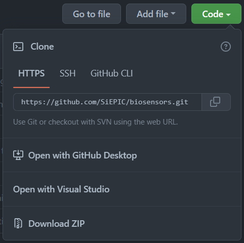

# Biosensor

TODO: Description of the project itself.

## How to use Git

Before starting, be familiar with the [command line and shell](https://missing.csail.mit.edu/2020/course-shell/). (At least the `cd` command)

[Download and Installation Guide](https://git-scm.com/downloads)

### Resources

[Documentation](https://git-scm.com/doc)

[Cheat Sheet](https://training.github.com/downloads/github-git-cheat-sheet)

[Learn Git Branching](https://learngitbranching.js.org) (~1h) is an alternative to learning git branching interactively, and also a sandbox to play with.

### User

If you only want to use this repo but not change it:

- Clone the repository

  

  If you don't need any version-control feature from git, `Download ZIP` and you can omit the remaining sections of this readme.

  **Recommended:** `cd` to a place for the code (the `git clone` command will create a folder named `biosensors` under the working directory)

  ```git
  git clone https://github.com/SiEPIC/biosensors.git
  ```

- Get the latest update

  This will reset your local version to the remote version:

  ```git
  git reset --hard origin
  ```

- Switch to commit

  1. List commits

  ```git
  git log

      commit b4363207acb8847089aef8f59283cc06b60350ea (HEAD -> main, origin/main, origin/HEAD)
      Author: EzekielDaun <liuyifei0905@gmail.com>
      Date:   Fri Aug 26 16:57:51 2022 -0700

          📖 update RA-GUI readme

      commit 6c2b0750e4bcb03764c195b85f4f5f3b98b2843e
      Author: EzekielDaun <liuyifei0905@gmail.com>
      Date: Fri Aug 26 14:22:33 2022 -0700

          📖 add usage guide for pyOptomip

      commit a774aea0a90b7bd50cc8b93aa6908ee873252529
      Merge: e32ba9e 12f7248
      Author: Yifei Liu <34564223+EzekielDaun@users.noreply.github.com>
  ```

  2. No need to type the full commit hash

  ```git
  git reset b436320
  ```

- Switch to branch
  ```git
  git checkout my_branch
  ```

### Developer

It's highly recommended for developers to be familiar with all topics in [Git Branching](https://learngitbranching.js.org), especially the `remote` section.

A typical git workflow is as follows:


A more advanced version for large projects:


For our project (a few developers with less frequent commits), a single main branch with feature/hotfix branches is enough.

A proposed workflow is:

1. check out a new branch from `main` with a proper name
2. commit your changes and push that branch to remote
3. create a Pull Request (PR) to merge your changes into `main` and request other members to review
4. update, commit and push your following modifications to that PR branch
5. merge into the main branch
6. delete feature/hotfix branch.

[GitHub-Flow](https://docs.github.com/en/get-started/quickstart/github-flow)

#### Merge Conflicts

When multiple members work on the same project, merge conflicts can be tricky. As of this writing, there has never been such a situation yet.

A few tips just in case it happens:

- When resolving merge conflicts, make sure to select the correct changes. Test the functionality after merge.
- Force push (`git push --force`) if you believe an overwrite is easier. And **BE CAREFUL**.
- Pull from origin frequently with the rebase option (`git pull --rebase`) to avoid/reveal potential conflicts in advance.

[More about force push and rebase](https://docs.gitlab.com/ee/topics/git/git_rebase.html)
